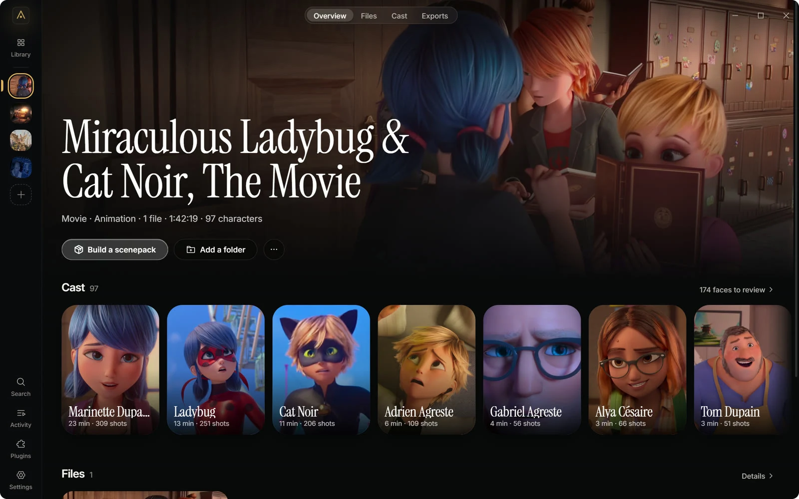
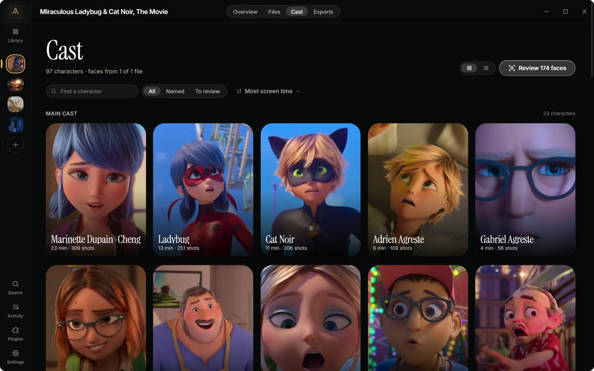
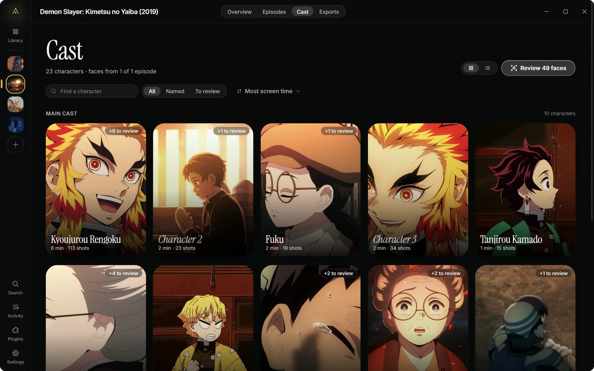
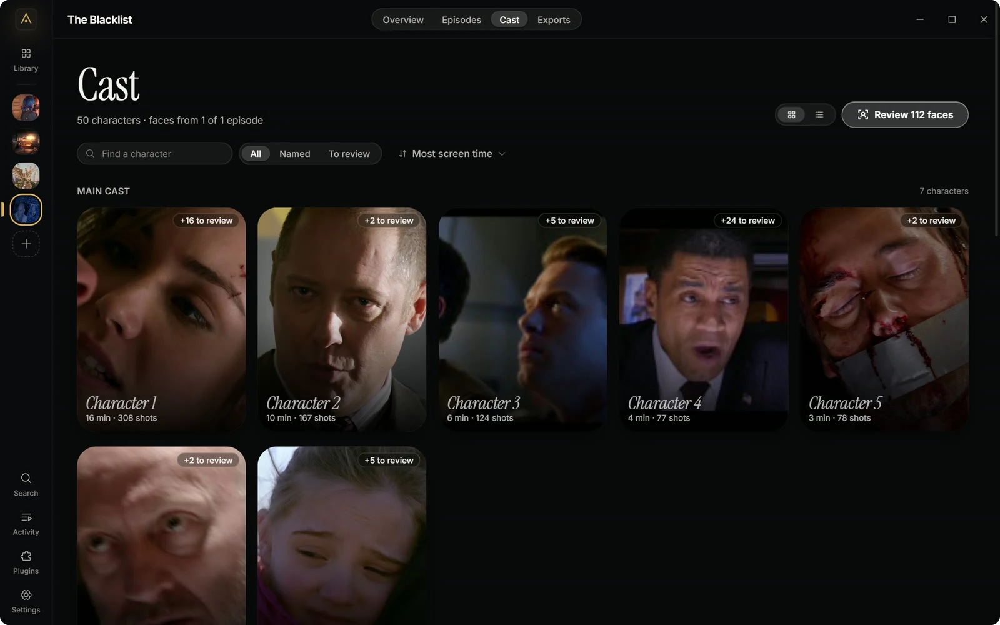
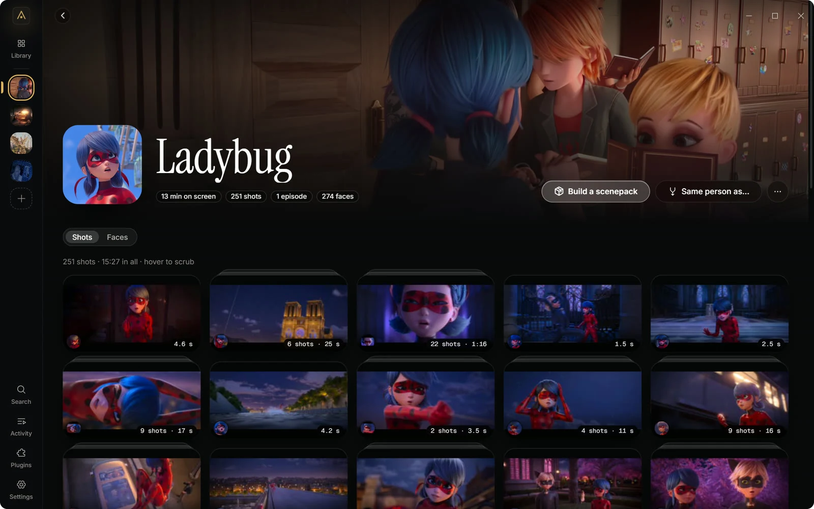
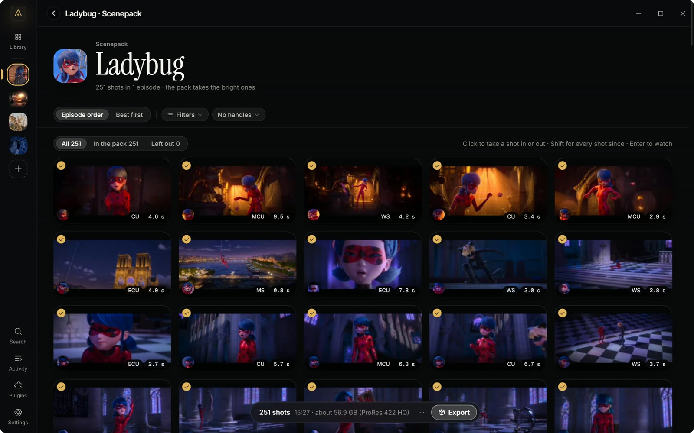
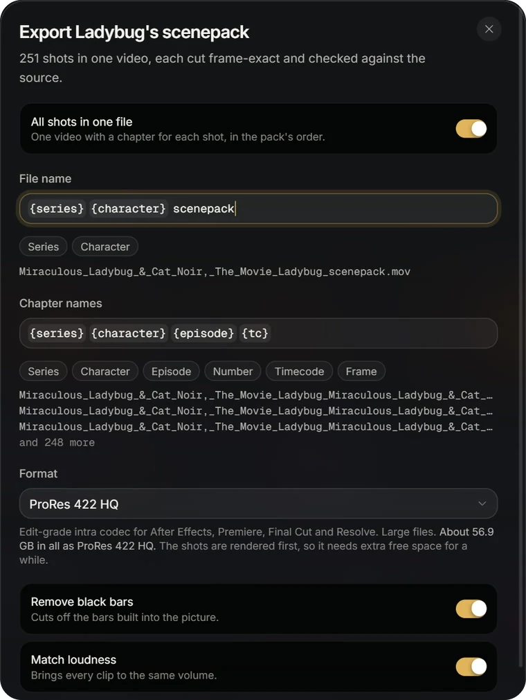
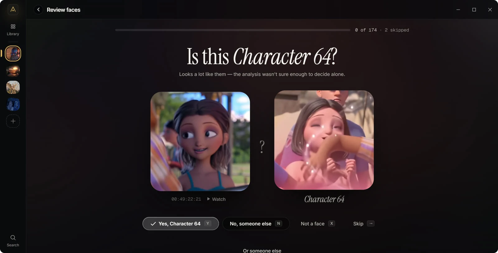
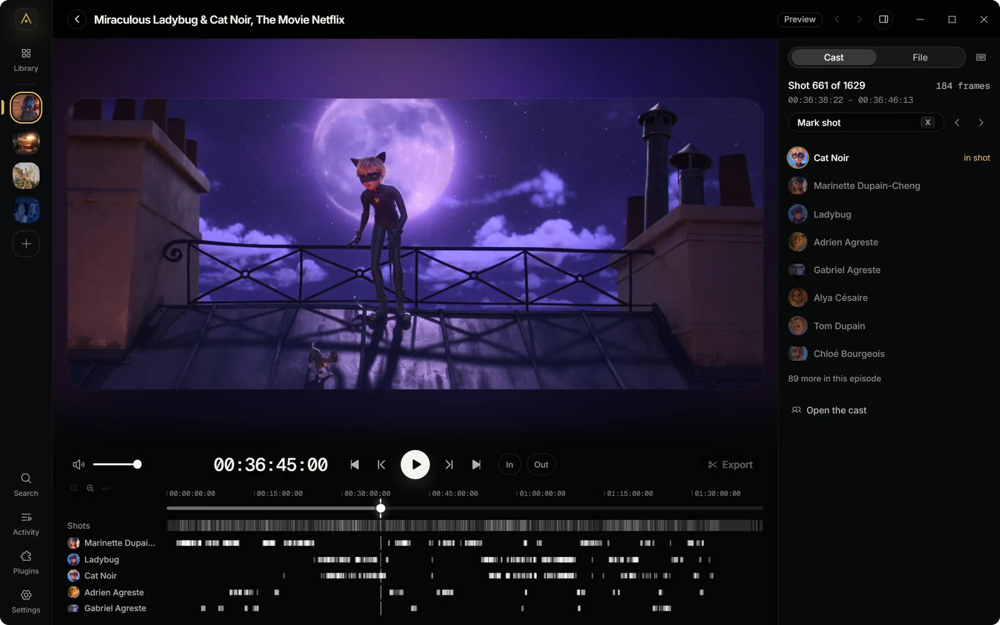
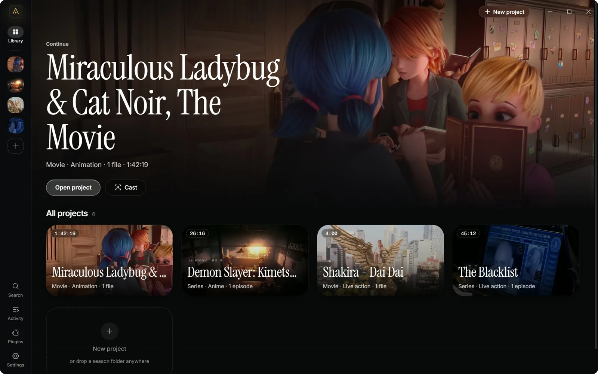

<div align="center">


# AutoScene

**Frame-exact character scenepacks from series and movies.**

Drop in a season or a film. AutoScene finds every shot and everyone in it,<br />
then hands you each character's scenes as clips ready for your edit.

[](https://github.com/tcmmi/AutoScene/releases/latest)
[](https://github.com/tcmmi/AutoScene/releases)
[](#download)
[](LICENSE)
[](https://discord.gg/autoscene)
<br />
[](https://www.rust-lang.org/)
[](https://tauri.app/)
[](https://react.dev/)

[**Download**](#download) • [Features](#features) • [Plugins](docs/PLUGINS.md) • [Build from source](#build-from-source) • [Discord](https://discord.gg/autoscene)

---

</div>

<p align="center">
  
</p>

## Features

### The cast finds itself

AutoScene finds the faces, follows them through every shot and groups them
into characters on its own. You only give them names. Your names and choices
stay, through every later analysis.

<p align="center">
  
</p>

Live action, anime and 3D animation each get their own way of telling
characters apart. For anime and animated films and series, one setting has
AutoScene look up the names on AniList, TVmaze and Fandom: a banner offers
them, and one click takes them.

<p align="center">
  
  
</p>
<p align="center"><sub>Anime (<i>Demon Slayer</i>) and live action (<i>The Blacklist</i>, before naming), straight from the analysis.</sub></p>

### Every shot of a character

Open a character and see every shot they're in. Rest the pointer on a card to
scrub through it. Shots that follow each other closely stack on one card.

<p align="center">
  
</p>

### A scenepack in one export

Every character gets a scenepack: their shots in episode order or best
first, with filters and your own picks on top.
One shortcut takes, drops or flips them all, with Undo.

<p align="center">
  
</p>



- **One file or many.** One video with a chapter for each shot, or a file per
  shot.
- **Named your way.** Buttons add the series, character, episode and timecode
  to file and chapter names.
- **Formats for every editor.** ProRes 422 HQ, DNxHR HQ, H.264 (for editing,
  all-intra for Twixtor, or mobile for CapCut and Alight Motion), 10-bit HEVC
  that keeps HDR, and **Bit-Perfect**: lossless, every pixel exactly the
  episode's.
- **Checked frame by frame.** Every clip is cut frame-exact and compared with
  the source. Frames of a fade or dissolve belong to no shot, so no clip
  starts halfway through one.
- **EDLs and cut lists** rebuild the cut from the episodes in your editor.
- **Coming in the next version:** remove black bars, and bring every clip to
  the same loudness.

<br clear="right" />

### Review faces in seconds

When the analysis isn't sure about a face, it asks you: <kbd>Y</kbd> yes,
<kbd>N</kbd> someone else, <kbd>X</kbd> not a face. Each answer applies to
similar faces at once.

<p align="center">
  
</p>

### A player made for editors

Frame-exact at every speed, with <kbd>J</kbd> <kbd>K</kbd> <kbd>L</kbd>
shuttle (backwards too), frame stepping, in and out points, and a zoomable
timeline with lanes for shots and characters. Start from Premiere Pro's or
DaVinci Resolve's keys, or set your own.

<p align="center">
  
</p>

### All your shows in one place

Series and films side by side, in live action, anime or animation. Episodes
are numbered from their
file names, and files you move or rename are found again: point AutoScene at
the folder, and your analysis is kept.

<p align="center">
  
</p>

### And more

- **Fast Scan.** Up to about three times as fast, at the cost of finding fewer
  faces. You choose it per project.
- **Characters without a visible face** (optional). AutoScene also follows
  people by their body and clothes, so shots where someone faces away still
  count for them.
- **Plugins** from a catalog we review: export actions, scenepack filters and
  whole pages of their own. [Write your own](docs/PLUGINS.md).
- **Runs on your graphics card** on Windows and on the Apple chip in a Mac, and
  picks up where it left off after a crash or a restart.
- **A command palette** (<kbd>Ctrl</kbd>/<kbd>⌘</kbd> + <kbd>K</kbd>) that also
  finds characters and episodes.
- **Updates itself**, and speaks English and Romanian.

## Download

Get the newest version from
[Releases](https://github.com/tcmmi/AutoScene/releases/latest).

| System | File |
| --- | --- |
| Windows 10 and 11 (x64) | `AutoScene_<version>_x64-setup.exe` |
| macOS 13 or later on Apple Silicon | `AutoScene_<version>_aarch64.dmg` |
| Linux (x64) | `.AppImage`, `.deb` or `.rpm` |

The builds aren't signed by a publisher yet, so the first start needs your OK
once:

- **Windows:** SmartScreen may say it protected your PC. Choose **More info →
  Run anyway**. (With Smart App Control on, Windows 11 offers no such choice:
  it blocks unsigned apps it doesn't know.) The installer fetches WebView2 if
  it's missing.
- **macOS:** drag AutoScene from the disk image to Applications and open it.
  macOS says it can't verify the app: close the message. Then open **System
  Settings → Privacy & Security**, scroll down to the note about AutoScene,
  choose **Open Anyway** and confirm. (Since macOS 15, right-click → Open no
  longer does this.) If macOS calls the app damaged (versions up to 1.0.1
  aren't signed) or later refuses a part of it, such as
  `libonnxruntime.dylib`, run
  `xattr -dr com.apple.quarantine /Applications/AutoScene.app` once.
- **Linux:** make the AppImage executable (`chmod +x AutoScene_*.AppImage`).
  WebKitGTK 4.1 is required for the `.deb` and `.rpm` packages.

AutoScene speaks English and Romanian: **Settings → General → App language**.

FFmpeg and ONNX Runtime ship with the app. The AI models (about 310 MB)
download the first time an analysis needs them.

<details>
<summary><b>Graphics: what the analysis runs on</b></summary>

Analysis runs on the graphics card through DirectML on Windows (any
DirectX 12 card) and on the Apple chip through Core ML on macOS; on Linux
it runs on the processor. **Settings → General → Hardware acceleration**
shows what it runs on. With two or more cards on Windows you can choose one
there, or the processor only, which is much slower; the choice applies from
the next analysis. A Mac keeps what Core ML compiled for the next start
(a compile unused for 30 days goes), so on a Mac a model waits for its compile once, and again after an
update that changes the model or the runtime.

**NVIDIA acceleration** is optional, for Windows (x64) with a GeForce RTX 30
series card or newer. Settings offers NVIDIA's engine, when analysis runs on that card, once you
agree to NVIDIA's licence there: about 111 MB from the Python Package Index
(which sees your IP address), 286 MB on disk, plus what it compiles as you use it. It speeds up the analysis of
anime. Live-action analysis (Fast Scan included) and shots don't use it. AutoScene neither
bundles nor hosts NVIDIA's files, and checks each against a SHA-256 pinned
in the release before it is used. If the engine doesn't load or a job ends
badly under it, analysis goes on without it, on DirectML. A switch turns it
off, and **Remove NVIDIA's files** deletes them and what they compiled.
Nothing changes for anyone who doesn't download it.

</details>

<details>
<summary><b>Check a download</b></summary>

Releases after 1.0.1 come with a signed record for every file (a build
attestation): the workflow of this repository that built it, and the tag and
commit it was built from. To check a file, use the
[GitHub CLI](https://cli.github.com), signed in with any GitHub account
(`gh auth login`):

```bash
gh attestation verify AutoScene_<version>_x64-setup.exe -R tcmmi/AutoScene
```

It shows the workflow and the tag. To insist on the release workflow, add
`--signer-workflow tcmmi/AutoScene/.github/workflows/release.yml`.

They also have a `SHA256SUMS` file with the SHA-256 of every other file. Put
it next to your downloads and run
`sha256sum --check --ignore-missing SHA256SUMS` (Linux) or
`shasum -a 256 --check --ignore-missing SHA256SUMS` (macOS). In PowerShell
on Windows, this prints `True` for an intact download:

```powershell
(Get-FileHash .\AutoScene_<version>_x64-setup.exe).Hash -eq (-split (Select-String -Path SHA256SUMS -Pattern x64-setup.exe -SimpleMatch).Line)[0]
```

</details>

## Build from source

You need:

- **Rust:** the nightly toolchain pinned in `rust-toolchain.toml`. `rustup`
  installs it.
- **Node:** version 26.
- **Windows:** Visual Studio with the C++ tools.
- **Linux:** the WebKitGTK development packages and `patchelf`. See `.github/workflows/ci.yml`.

```bash
cargo xtask fetch-sidecars        # pinned FFmpeg + ONNX Runtime into app/src-tauri
cd app
npm ci
npm run tauri:dev                 # the app with hot reload
npm run tauri:build               # installers in target/release/bundle
```

Tests:

```bash
cargo xtask fixtures              # synthetic test media
cargo xtask wasm-guests           # the WebAssembly plugins the sandbox tests run
cargo test --workspace --features as-plugin/cli
cd app && npm test
```

## Layout

| Path | What |
| --- | --- |
| `crates/` | The Rust core: media and frame index (`as-media`), projects and database (`as-project`, `as-db`), analysis engine and inference (`as-engine`, `as-infer`, `as-analysis`, `as-identity`), exports (`as-export`), plugins and the `asp` tool (`as-plugin`) |
| `app/` | The desktop app: Tauri shell (`app/src-tauri`) and React UI (`app/src`) |
| `app/redteam/` | A test app that tries every known way out of a plugin page |
| `xtask/` | Dev tasks: sidecars, fixtures, test models |
| `models/manifest.toml` | The AI models, pinned by URL and SHA-256 |
| `tools/model-prep/` | Dev-only Python that prepares models (never shipped) |
| `docs/DESIGN.md` | The design system |
| `docs/PLUGINS.md` | How to write, package and sign a plugin |
| `docs/CATALOG.md` | AutoScene's plugin catalog: its signed index, its keys, `asp catalog` and the runbook |
| `SECURITY.md` | How to report a security hole privately, and what counts |
| `examples/plugins/` | Seven example plugins: export actions (`hello-export`, and `discord-notify` with a secret, `net.fetch` and an event), a page (`hello-page`), a service (`hello-service`), a shot filter with a pack action (`bright-shots`), and two that run in the sandbox as WebAssembly (`discord-notify-wasm` in Rust, `clip-list-py` in Python) |

`src/autoscene/` and `ui/` hold AutoScene 0.1, the Python-based version. They
stay until this version also has its dialogue search, smart tags and frame
interpolation.

## Models and licences

The full face pass's models (SCRFD and ArcFace, with the people models)
come from InsightFace and may only be used non-commercially; Fast Scan's
(YuNet, SFace) are MIT and Apache-2.0. Anime's head and person detectors
(deepghs) are MIT; its character embedder, CCIP, is under OpenRAIL, whose
use restrictions apply. The shot detector, TransNetV2, is MIT-licensed. **Settings → About** shows each model's licence. `models/manifest.toml` lists
the source and licence of each model.

## Community

- **Questions, ideas, plugins:** join us on [Discord](https://discord.gg/autoscene).
- **Found a bug?** Open an [issue](https://github.com/tcmmi/AutoScene/issues).
- **Found a security hole?** Report it privately, as [SECURITY.md](SECURITY.md)
  says.

## License

AutoScene's code is under the [Apache License 2.0](LICENSE). The AI models
have licences of their own (see [Models and licences](#models-and-licences)).
